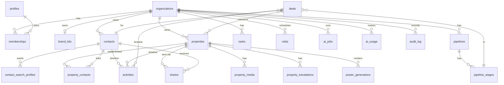

# 03 — Modèle de données

> Esquisse de référence : les noms et types guideront les premières migrations, ils pourront évoluer. Convention : `snake_case`, clés `uuid` (v7 si disponible), `created_at/updated_at/created_by`, suppression logique (`deleted_at`) sur les entités métier. **Toute table métier a `organization_id`.**

## 1. Diagramme logique



## 2. Tables principales

### Plateforme & accès
```sql
create table organizations (
  id uuid primary key default gen_random_uuid(),
  slug text unique not null,                 -- sous-domaine
  name_fr text, name_he text, name_en text,
  default_locale text not null default 'fr' check (default_locale in ('fr','he','en')),
  default_currency text not null default 'ILS',
  timezone text not null default 'Asia/Jerusalem',
  plan text not null default 'trial',
  status text not null default 'active',     -- active|suspended|archived
  settings jsonb not null default '{}'::jsonb, -- ex: contact_visibility, weekend_days
  created_at timestamptz default now()
);

create table profiles (                      -- 1:1 avec auth.users
  id uuid primary key references auth.users on delete cascade,
  full_name text, avatar_url text,
  preferred_locale text default 'fr',
  phone text
);

create type member_role as enum ('owner','admin','agent','assistant','viewer');

create table memberships (
  organization_id uuid references organizations on delete cascade,
  user_id uuid references profiles on delete cascade,
  role member_role not null,
  status text not null default 'active',     -- active|invited|disabled
  primary key (organization_id, user_id)
);

create table role_capabilities (             -- rôles = capacités, configurables par org
  organization_id uuid references organizations,   -- null = valeurs par défaut globales
  role member_role not null,
  capability text not null,                  -- ex: 'contacts.read_all', 'exports.run'
  primary key (organization_id, role, capability)
);

create table invitations (
  id uuid primary key default gen_random_uuid(),
  organization_id uuid not null references organizations,
  email text not null, role member_role not null,
  token_hash text not null, expires_at timestamptz not null,
  accepted_at timestamptz
);

create table platform_admins (user_id uuid primary key references profiles);  -- vous

create table brand_kits (
  organization_id uuid primary key references organizations,
  source_url text,
  logo_light_path text, logo_dark_path text, logo_mark_path text,
  colors jsonb not null,        -- {primary, secondary, accent, neutral, ...} en OKLCH + hex
  fonts jsonb not null,         -- {heading, body, hebrew_heading, hebrew_body} (famille + source)
  style jsonb not null,         -- {radius, density, tone, imagery}
  legal_footer jsonb,           -- {fr,he,en} mentions légales / n° de licence
  contact_block jsonb,          -- tél, site, e-mail, réseaux
  version int not null default 1,
  updated_at timestamptz default now()
);
```

### Contacts
```sql
create type contact_kind as enum ('buyer','seller','landlord','tenant','investor','lawyer','partner','other');

create table contacts (
  id uuid primary key default gen_random_uuid(),
  organization_id uuid not null references organizations,
  kinds contact_kind[] not null default '{buyer}',
  first_name text, last_name text,
  first_name_he text, last_name_he text,
  company text,
  phones jsonb not null default '[]',        -- [{e164, label, is_whatsapp, primary}]
  emails jsonb not null default '[]',
  phone_primary_e164 text generated always as ((phones->0->>'e164')) stored,
  preferred_locale text default 'fr',
  country_of_residence text,
  aliyah_status text,                        -- pre_aliyah|recent|resident|none
  source_id uuid references lead_sources,
  status text not null default 'active',
  owner_id uuid references profiles,         -- agent référent
  budget_min numeric, budget_max numeric, budget_currency text,
  financing jsonb,                           -- {mortgage_approved, amount, bank}
  tags text[] default '{}',
  custom jsonb not null default '{}',
  marketing_consent jsonb,                   -- {granted, at, channel, proof}
  do_not_contact boolean default false,
  notes text,
  search_text text,                          -- normalisé (hébreu/latin)
  deleted_at timestamptz,
  created_at timestamptz default now(), created_by uuid
);
create index on contacts (organization_id, owner_id, status);
create index on contacts using gin (search_text gin_trgm_ops);
create unique index on contacts (organization_id, phone_primary_e164)
  where phone_primary_e164 is not null and deleted_at is null;  -- anti-doublon dur

create table contact_search_profiles (       -- critères d'un acheteur/locataire (plusieurs possibles)
  id uuid primary key default gen_random_uuid(),
  organization_id uuid not null references organizations,
  contact_id uuid not null references contacts on delete cascade,
  transaction text,                          -- sale|rent
  property_types text[], city_ids uuid[], neighborhood_ids uuid[],
  price_min numeric, price_max numeric, currency text,
  rooms_min numeric, rooms_max numeric,
  area_min numeric, area_max numeric, floor_min int, floor_max int,
  must_have text[] default '{}',             -- ['mamad','parking','elevator']
  nice_to_have text[] default '{}',
  move_in_by date, active boolean default true
);
```

### Biens
```sql
create type transaction_type as enum ('sale','rent','commercial_sale','commercial_rent');
create type property_status as enum ('draft','active','under_offer','sold','rented','withdrawn','expired');

create table properties (
  id uuid primary key default gen_random_uuid(),
  organization_id uuid not null references organizations,
  reference text not null,                   -- ex: EL-2026-0142 (séquence par org)
  transaction transaction_type not null,
  property_type text not null,               -- apartment|garden_apt|penthouse|duplex|house|cottage|land|office|shop…
  status property_status not null default 'draft',
  agent_id uuid references profiles,
  city_id uuid references geo_places, neighborhood_id uuid references geo_places,
  street text, house_number text, apartment_number text,
  address_visibility text default 'street',  -- hidden|neighborhood|street|exact
  location geography(Point,4326),
  price numeric, currency text default 'ILS', price_negotiable boolean,
  rooms numeric(3,1), bedrooms int, bathrooms int,
  area_built numeric, area_garden numeric, area_balcony numeric,
  floor int, floors_total int, year_built int,
  mamad boolean, sukkah_balcony boolean, elevator boolean, parking_count int,
  storage boolean, ac boolean, accessible boolean, furnished text,
  condition text, tama38 boolean,
  arnona_monthly numeric, vaad_bayit_monthly numeric,
  registration_type text,                    -- tabu|minhal|company|other
  entry_date date, entry_flexible boolean,
  mandate jsonb,                             -- {type, start, end, commission_pct, signed_doc_id}
  features text[] default '{}',
  custom jsonb default '{}',
  internal_notes text,
  published_at timestamptz, public_token text unique,
  search_text text,
  deleted_at timestamptz, created_at timestamptz default now(), created_by uuid,
  unique (organization_id, reference)
);
create index on properties (organization_id, status, transaction, city_id, price);
create index on properties using gist (location);
create index on properties using gin (search_text gin_trgm_ops);

create table property_translations (         -- titre/description par langue
  property_id uuid references properties on delete cascade,
  organization_id uuid not null,
  locale text check (locale in ('fr','he','en')),
  title text, description text,
  origin text default 'manual',              -- manual|ai
  reviewed boolean default false,
  primary key (property_id, locale)
);

create table property_media (
  id uuid primary key default gen_random_uuid(),
  organization_id uuid not null, property_id uuid references properties on delete cascade,
  kind text,                                 -- photo|video|plan|doc|tour360
  storage_path text, width int, height int, position int,
  is_cover boolean default false, visibility text default 'public',  -- public|internal
  caption jsonb                               -- {fr,he,en}
);

create table property_contacts (             -- propriétaire, locataire actuel, etc.
  property_id uuid references properties on delete cascade,
  contact_id uuid references contacts on delete cascade,
  organization_id uuid not null,
  relation text not null,                    -- owner|tenant|other
  primary key (property_id, contact_id, relation)
);

create table property_price_history (
  id bigint generated always as identity primary key,
  organization_id uuid not null, property_id uuid,
  price numeric, currency text, changed_at timestamptz default now(), changed_by uuid
);
```

### Pipeline, activités, tâches, visites
```sql
create table pipelines (id uuid primary key default gen_random_uuid(), organization_id uuid not null, name jsonb, is_default boolean);
create table pipeline_stages (
  id uuid primary key default gen_random_uuid(), organization_id uuid not null,
  pipeline_id uuid references pipelines, name jsonb,      -- {fr,he,en}
  position int, probability int, kind text                -- open|won|lost
);

create table deals (
  id uuid primary key default gen_random_uuid(), organization_id uuid not null,
  contact_id uuid references contacts, stage_id uuid references pipeline_stages,
  property_ids uuid[], agent_ids uuid[],
  value numeric, currency text, commission_pct numeric, commission_split jsonb,
  expected_close date, lost_reason_id uuid, closed_at timestamptz, created_at timestamptz default now()
);

create table activities (                    -- timeline polymorphe
  id uuid primary key default gen_random_uuid(), organization_id uuid not null,
  kind text not null,                        -- note|call|email|whatsapp|visit|stage_change|share|system
  contact_id uuid, property_id uuid, deal_id uuid,
  actor_id uuid, occurred_at timestamptz default now(),
  summary text, payload jsonb
);
create index on activities (organization_id, contact_id, occurred_at desc);

create table tasks (
  id uuid primary key default gen_random_uuid(), organization_id uuid not null,
  title text, due_at timestamptz, priority int, assignee_id uuid,
  contact_id uuid, property_id uuid, deal_id uuid, done_at timestamptz,
  recurrence text
);

create table visits (
  id uuid primary key default gen_random_uuid(), organization_id uuid not null,
  property_id uuid, contact_id uuid, agent_id uuid,
  starts_at timestamptz, ends_at timestamptz, status text,
  feedback jsonb, signature_path text
);
```

### Envois, marketing, IA
```sql
create table shares (                        -- un envoi de bien(s) à un client
  id uuid primary key default gen_random_uuid(), organization_id uuid not null,
  contact_id uuid, sender_id uuid, channel text,         -- email|whatsapp_link|link
  property_ids uuid[], locale text, token text unique,
  sent_at timestamptz, opened_at timestamptz, clicked jsonb, client_feedback jsonb
);

create table email_messages (
  id uuid primary key default gen_random_uuid(), organization_id uuid not null,
  share_id uuid, contact_id uuid, provider_id text,
  subject text, status text, events jsonb default '[]'
);

create table message_templates (
  id uuid primary key default gen_random_uuid(), organization_id uuid,   -- null = global par défaut
  kind text, locale text, subject text, body text, variables text[]
);

create table poster_templates (
  id uuid primary key default gen_random_uuid(), organization_id uuid,   -- null = galerie globale
  name text, format text, layout jsonb, locked boolean, created_by uuid
);

create table poster_generations (
  id uuid primary key default gen_random_uuid(), organization_id uuid not null,
  property_id uuid, template_id uuid, format text, locale text,
  prompt_params jsonb, ai_background_path text, output_path text,
  status text, cost_credits numeric, created_by uuid, created_at timestamptz default now()
);

create table ai_jobs (
  id uuid primary key default gen_random_uuid(), organization_id uuid not null,
  kind text not null,                        -- intake_voice|intake_photo|translate|poster_bg|brand_extract
  input_path text, input_meta jsonb,
  status text default 'queued',              -- queued|running|needs_review|done|failed
  result jsonb,                              -- sortie structurée + confiance par champ
  target_entity text, target_id uuid,        -- après validation humaine
  error text, created_by uuid, created_at timestamptz default now(), finished_at timestamptz
);

create table ai_usage (
  id bigint generated always as identity primary key,
  organization_id uuid not null, user_id uuid, job_id uuid,
  provider text, model text, units jsonb, cost_usd numeric, credits numeric,
  created_at timestamptz default now()
);
```

### Transverse
```sql
create table audit_log (
  id bigint generated always as identity primary key,
  organization_id uuid, actor_id uuid, impersonated_by uuid,
  action text, entity text, entity_id uuid, diff jsonb, ip inet, at timestamptz default now()
);                                            -- INSERT seulement (aucune policy UPDATE/DELETE)

create table geo_places (                     -- villes, quartiers (référentiel partagé + alias)
  id uuid primary key default gen_random_uuid(), parent_id uuid, kind text,
  name_fr text, name_he text, name_en text, aliases text[], centroid geography(Point,4326)
);

create table custom_field_defs (…);           -- champs personnalisés par entité
create table saved_views (…);                 -- filtres/colonnes enregistrés
create table lead_sources (…); create table lost_reasons (…); create table tags (…);
create table notifications (…); create table feature_flags (organization_id, key, enabled);
create table subscriptions (organization_id, stripe_customer_id, plan, seats, ai_credits_balance, …);
create table webhooks (…); create table api_keys (…);
create table consents_log (…);                -- preuve d'opt-in/out
```

> `geo_places` est un référentiel global (sans `organization_id`) en lecture seule pour les tenants ; seules données sans colonne org avec `message_templates`/`poster_templates` globaux (policy dédiée « org null = lecture seule »).

## 3. Exemple de RLS

```sql
alter table properties enable row level security;
alter table properties force row level security;

create policy "properties_select" on properties for select to authenticated
using (organization_id = (select (auth.jwt() ->> 'org_id')::uuid) and deleted_at is null);

create policy "properties_insert" on properties for insert to authenticated
with check (
  organization_id = (select (auth.jwt() ->> 'org_id')::uuid)
  and (select app.has_capability('properties.write'))
);

create policy "properties_update" on properties for update to authenticated
using (
  organization_id = (select (auth.jwt() ->> 'org_id')::uuid)
  and ( agent_id = auth.uid() or (select app.has_capability('properties.write_all')) )
);

-- contacts : visibilité réglable par organisation
create policy "contacts_select" on contacts for select to authenticated
using (
  organization_id = (select (auth.jwt() ->> 'org_id')::uuid)
  and (
    (select app.has_capability('contacts.read_all'))
    or owner_id = auth.uid()
    or exists (select 1 from contact_shares s where s.contact_id = contacts.id and s.user_id = auth.uid())
  )
);
```

`app.has_capability(text)` lit le rôle du JWT et la table `role_capabilities` (fonction `stable`, `security definer`, résultat mis en cache par requête).

## 4. Règles d'intégrité utiles
- Téléphones normalisés en E.164 côté serveur (ex. `050-1234567` → `+972501234567`), contrainte d'unicité anti-doublon par organisation.
- `reference` de bien générée par séquence par organisation (table `org_counters` + `update … returning`).
- `deleted_at` : corbeille 30 j, purge automatique (`pg_cron`) ; la purge écrit dans `audit_log`.
- Triggers `updated_at`, historique de prix, activité automatique sur changement de statut/étape.
- Colonne `search_text` maintenue par trigger (normalisation hébreu : retrait niqqud U+0591–U+05C7, unification des formes finales si besoin, minuscules, `unaccent`).

## 5. Performance
- Tous les index composites commencent par `organization_id`.
- Requêtes de liste : keyset pagination + `select` de colonnes restreintes ; vues matérialisées (ou tables de cache) pour les KPI du dashboard, rafraîchies par `pg_cron`.
- Matching : requête SQL de scoring (critères obligatoires en `WHERE`, souhaités en somme pondérée) — suffisant jusqu'à plusieurs dizaines de milliers de biens/contacts par agence.
