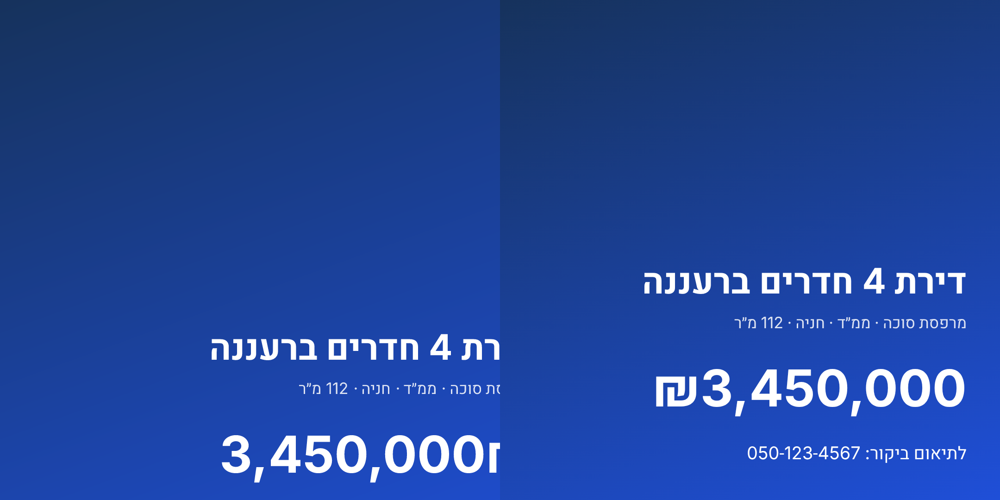

# 07 — Phase 0 : résultats

## Livré
| Élément | État | Vérification |
|---|---|---|
| Monorepo pnpm, CI GitHub Actions (web + isolation DB) | ✅ | `.github/workflows/ci.yml` |
| Schéma multi-tenant (organisations, membres, rôles-capacités, contacts, biens, médias, activités, audit, brand kit, usage IA) | ✅ | migrations `2026110400000{1..4}` |
| RLS sur toutes les tables + helpers `app.org_id()/role()/has_capability()` | ✅ | **41 assertions** SQL, `pnpm test:db` |
| Hook JWT `org_id` + `switch_organization()` (multi-agences par utilisateur) | ✅ SQL testé · ⚠️ branchement Supabase réel non testé (pas de Docker/projet ici) | `config.toml` |
| `provision_organization()` (nouvelle agence isolée + owner + sources par défaut + brand kit) | ✅ | tests |
| Next.js 16 + next-intl FR/HE/EN, `dir` RTL, CSS logique imposé par script | ✅ | `pnpm lint`, captures navigateur |
| Thème par agence (OKLCH, contraste AA garanti) | ✅ | 10 tests unitaires |
| Auth : Google OAuth + magic link (invitation seule), proxy de session | ✅ code · ⚠️ non exécuté contre un vrai projet Supabase | build OK |
| Spike 1 : rendu d'affiches hébreu | ✅ | `spikes/poster-render` |
| Spikes 2–4 (STT, vision manuscrite, charte depuis URL) | ⏳ nécessitent clés API et échantillons réels | `spikes/README.md` |
| Maquettes haute fidélité des 8 écrans | ⏳ non commencé | — |

## Ce que prouvent les tests d'isolation
Un utilisateur de l'agence A ne peut, ni lire, ni insérer, ni modifier, ni supprimer, ni déplacer vers B aucune ligne ; un non-membre avec un `org_id` forgé n'obtient rien ; un membre désactivé ou une agence suspendue perd l'accès **immédiatement** ; un agent ne gère ni membres, ni capacités, ni audit ; la visibilité des contacts est réglable par agence ; `anon` n'a aucun privilège ; chaque table `public` a RLS + policy + `organization_id NOT NULL` (test de couverture structurel qui échoue si on oublie une table).

## Spike 1 — Satori vs Chromium (hébreu RTL)

Satori avec `direction: rtl` : titre et sous-titre débordent à gauche du canevas, le prix est tronqué (₪ coupé), la ligne de contact est absente. Chromium : rendu correct. **Décision : Chromium headless** derrière `PosterRenderer` (conteneur dédié en prod ; les fonctions serverless Vercel imposent de packager Chromium, à valider en phase 2).
*Limite : j'ai testé une configuration Satori ; je n'ai pas exploré toutes les contournements (inversion manuelle des segments). Le gain d'un moteur léger ne justifie pas ce risque.*

## Écarts par rapport au spec
- `FORCE ROW LEVEL SECURITY` non utilisé (raisons dans `02-architecture.md` §3) ; l'isolation est compensée par les tests.
- Positions géographiques en `lat/lng` pour l'instant ; PostGIS arrive avec la carte (phase 1).
- Pas de pgTAP : tests en SQL pur, exécutables sans extension ni Docker (Postgres 16 jetable).

## Prérequis pour la suite (à fournir par vous)
1. Projet Supabase (dev) + identifiants Google OAuth → pour tester l'auth et le hook JWT en réel.
2. Clés API IA (STT / vision / image) + 10 dictées et 10 papiers manuscrits réels anonymisés → spikes 2–4.
3. Réponses aux questions ouvertes de `06-roadmap-couts-idees.md` §5.
